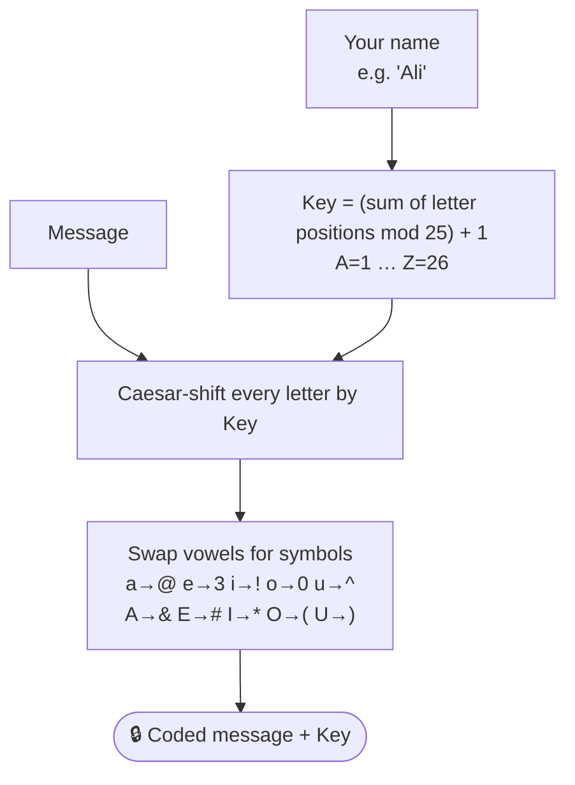

<div align="center">

# 🔐 ManifestO

**Turn any message into a secret code and back again — a playful MERN cipher app where your name becomes the encryption key.**

[](https://manifest-o.vercel.app/)


[How it works](#-how-the-cipher-works) · [Example](#-how-the-cipher-works) · [Getting Started](#-getting-started) · [API](#-api-reference) · [Structure](#-project-structure)

</div>

---

## ✨ Features

- ✍️ **Encrypt** — enter your name and a message, get back a coded message **and** a numeric key
- 🔓 **Decrypt** — paste a coded message with its key to reveal the original
- 📋 **One-click copy** for both the coded message and the key
- 🗃️ **Activity log** — every encryption/decryption is stored in MongoDB (`Visitors` collection)
- 🧭 Separate **Home**, **Encryption** and **Decryption** pages with a sidebar

## 🧠 How the cipher works



Decryption runs the same steps in reverse: symbols → vowels, then shift each letter back by the key.

<details>
<summary><b>🔍 Example</b></summary>

<br/>

| Step | Value |
|---|---|
| Name | `Ali` → A(1) + L(12) + I(9) = 22 → `22 mod 25 + 1` = **key 23** |
| Message | `Hello` |
| Caesar shift by 23 | `Ebiil` |
| Vowel → symbol | `Eb!!l` → **`#b!!l`** |

So `Hello` from *Ali* becomes **`#b!!l`** with key **23**.

</details>

## 🚀 Getting Started

### Prerequisites

- Node.js 18+
- A MongoDB connection string (local or Atlas)

<details open>
<summary><b>1️⃣ Backend (<code>server/</code>)</b></summary>

```bash
cd server
npm install
cp .env.sample .env      # set MONGO_URI and PORT
npm start                # http://localhost:5000
```

</details>

<details open>
<summary><b>2️⃣ Frontend (repo root)</b></summary>

```bash
npm install
cp .env.sample .env      # REACT_APP_API_BASE_URL=http://localhost:5000
npm start                # http://localhost:3000
```

</details>

<details>
<summary><b>⚙️ Environment variables</b></summary>

| File | Variable | Description |
|---|---|---|
| `server/.env` | `MONGO_URI` | MongoDB connection string |
| `server/.env` | `PORT` | API port (default `5000`) |
| `.env` | `REACT_APP_API_BASE_URL` | Base URL of the Express API |

</details>

## 📡 API Reference

| Method | Endpoint | Body | Returns |
|---|---|---|---|
| `POST` | `/api/encrypt` | `{ "sender": "Ali", "msg": "Hello" }` | `{ "encodedMessage": "#b!!l", "key": 23 }` |
| `POST` | `/api/decrypt` | `{ "sender": 23, "msg": "#b!!l" }` | `{ "decodedMessage": "Hello" }` |

> For `/api/decrypt`, `sender` carries the **key**.

## 📁 Project Structure

<details>
<summary><b>Expand tree</b></summary>

```text
ManifestO/
├── src/
│   ├── components/      # Form (shared encrypt/decrypt form), Sidebar, Footer
│   ├── pages/           # Home, Encryption, Decryption
│   └── App.jsx          # routes: /, /encryption, /decryption
└── server/
    ├── routes/          # encrypt.js, decrypt.js
    ├── utils/           # encryption.js, decryption.js  ← the cipher
    ├── models/Visitors.js
    └── server.js
```

</details>

> ⚠️ ManifestO is a fun, educational cipher — not real cryptography. Don't use it to protect sensitive data.

## 📜 License

[MIT](LICENSE)

---

<div align="center">

Built by **[Shariq](https://github.com/Shariq2003)** · [LinkedIn](https://www.linkedin.com/in/shariq-sd)

⭐ If you like this project, consider giving it a star!

</div>
